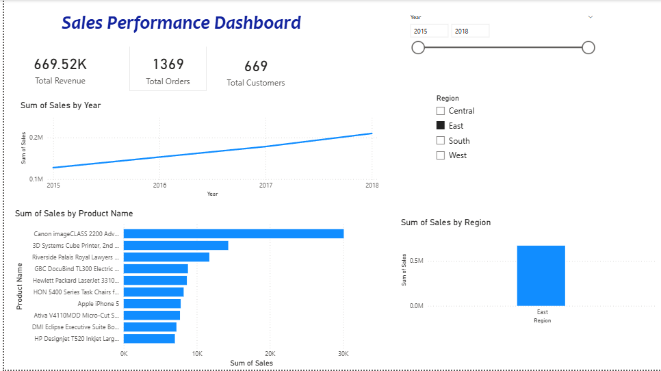

# Sales Performance Dashboard

An end-to-end data analysis project on retail sales data. I cleaned and analyzed the data using Excel and Python, then built an interactive Power BI dashboard.

## Tools Used
- Excel (initial data checks)
- Python: Pandas, Matplotlib (cleaning and analysis)
- Power BI (interactive dashboard)

## Dataset
Superstore Sales Dataset from Kaggle (9,800 rows, 18 columns, 2015-2018).

## Data Cleaning
- Checked for duplicate rows: none found
- Found 11 missing Postal Codes (all Burlington, Vermont) and filled them
- Converted Order Date and Ship Date from text to datetime
- Added Year and Month columns

## Key KPIs
- Total Revenue: 2.26M
- Total Orders: 4,922
- Total Customers: 793

## Key Insights
- Sales grew about 50% from 2015 to 2018, with a small dip in 2016.
- West and East together bring about 61% of revenue. South is the lowest at 17%.
- Technology is the top category (37% of revenue).
- The top product, Canon imageCLASS 2200 Advanced Copier, earns about double the second best product.

## Dashboard Features
- KPI cards: Total Revenue, Total Orders, Total Customers
- Charts: Sales by Region, Sales by Year, Top 10 Products
- Slicers for Year and Region to filter the whole dashboard

## Files
- `analysis.ipynb`: Python cleaning and analysis
- `cleaned_superstore.csv`: cleaned dataset
- `Sales_Dashboard.pbix`: Power BI dashboard
- `dashboard.png`: dashboard screenshot
- `charts.png`: Python charts
